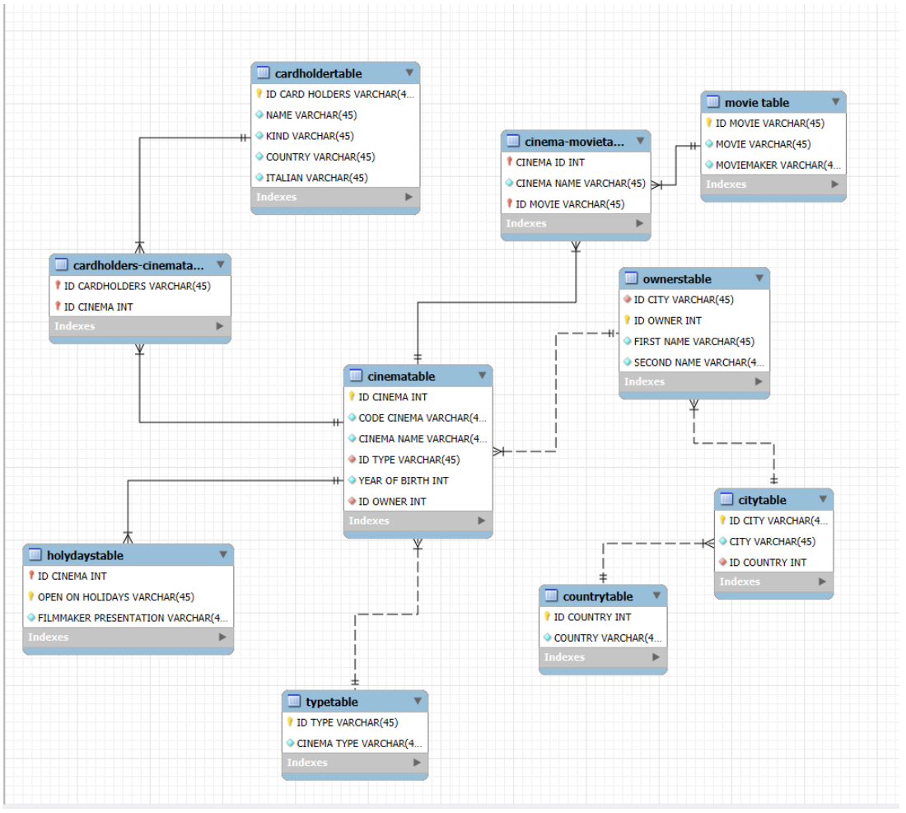

# Cinema-and-chill-database
Relational database design for a fictional cinema chain using MySQL, including data normalisation, primary and foreign keys, Excel data import and EER modelling.
# Cinema & Chill | Relational Database Design

**Academic group project · Information System and Database Management**  
**Tools:** MySQL, Excel  
**Focus:** Relational data modelling, database normalisation, primary and foreign keys, referential integrity, EER diagrams

## Project overview

**Cinema & Chill** is a fictional cinema chain used as the case study for a relational database design project. The aim was to organise information about cinema venues, their locations and types, films, administrators, and cardholders into a structured database.

The project follows the design process from defining entities and relationships to normalising tables, importing example data into MySQL, and producing an **Enhanced Entity–Relationship (EER) diagram**.

## Database design

The database represents several aspects of the fictional cinema business:

- **Cinema venues:** Different types of cinemas, including multiplexes, open-air cinemas, and movie theatres, operating across different cities.
- **Films and venues:** Relationships between films and the cinemas where they are offered.
- **Cardholders and cinemas:** A many-to-many relationship, represented through an association table with foreign keys to the related entities.
- **Organisational details:** Information about cities and the administrators associated with cinema locations.

The design documents the use of **primary keys**, **foreign keys**, and **referential integrity**. The presentation also works through examples of first, second, and third normal forms to explain how redundant or partially dependent attributes can be separated into related tables.

## Implementation and outputs

1. Organised the example information into relational tables and defined the relevant identifiers and relationships.
2. Examined database normalisation, including 1NF, 2NF, and 3NF.
3. Imported sample tables from Excel into MySQL using the table data import workflow.
4. Configured data types and primary/foreign-key relationships.
5. Produced an EER diagram to visualise the database schema.

### EER diagram

*EER diagram reproduced from the original academic project presentation.*

## Project materials

- [Project presentation (PDF)](presentation.pdf) – Slides covering the case study, data modelling, normalisation, data import, and EER diagram.
- [Original PowerPoint presentation](presentation.pptx) – Editable presentation created for the group project.
- [Data notes](data/README.md) – Description of the fictional example data and availability.

## Reproducibility and scope

This repository documents the **database design and its implementation workflow**, rather than providing a ready-to-run SQL application. The original SQL scripts and Excel source files are not included. The presentation provides screenshots and examples of the implementation in MySQL, but these are not substitutes for executable SQL scripts.

All cinema-chain examples were created for an academic exercise and do not describe a real business.

## Contributors

Academic group project by **Lisa Rigo**, **Paola D’Amore**, and **Samuel Soncini**.
